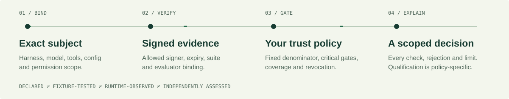

# KYA Evidence

**A passport says what an agent is. Evidence shows what an exact agent system did, under an exact scope.**

KYA Evidence is local-first open infrastructure for **Know Your Agent**: portable agent passports, signed check receipts, configurable relying-party policies and explainable assurance assessments. The vision is a neutral standard that people, organizations and independent assessors can implement, reproduce and contest. The current deliverable is a dependency-free Node.js reference implementation, **v0.1 alpha**, not an adopted industry standard.

Every person may eventually delegate to an agent. Every relying party will need a better answer than “trust the prompt.” Start with an exact question: **does this configuration meet this party's policy for this scope, on this evidence?** Keep the result portable, the decision explainable and the correction process open.

[Specification](docs/SPECIFICATION.md) · [Scoring](docs/SCORING.md) · [Research universes](docs/UNIVERSES.md) · [Threat model](docs/THREAT-MODEL.md) · [Adapters](docs/ADAPTERS.md) · [Roadmap](docs/ROADMAP.md) · [Contribute](CONTRIBUTING.md)

## Run from a checkout

Requires Node.js 22 or later. The fixture demonstration needs no runtime dependencies, API keys or network access. This package is not yet published to npm.

```sh
node bin/kya.mjs demo --out ./artifacts/demo
node --test test/*.test.mjs
node scripts/serve.mjs
```

Open the local URL printed by the server to explore five reference cases: careful, unsafe, unknown, tampered and revoked. The demo and dashboard presets are **synthetic fixtures**. A perfect fixture score does not measure Claude Code, Codex, bots or any other real agent. Imported assessment JSON is displayed as claimed, unverified data.

```sh
node bin/kya.mjs assess \
  --manifest ./manifest.json \
  --profile ./profiles/core-v1.json \
  --policy ./policy.json \
  --evidence ./evidence.json \
  --evaluator <64-character-evaluator-digest> \
  --now 2026-10-13T12:00:00.000Z \
  --out ./artifacts/assessment

node bin/kya.mjs inspect .
node bin/kya.mjs verify ./artifacts/assessment/assessment.json
node bin/kya.mjs probe --out ./artifacts/runtime-probes.json
node bin/kya.mjs benchmark --out ./artifacts/benchmark
```

Use generated demo inputs and the [adapter protocol](docs/ADAPTERS.md) to connect an explicitly authorized runtime. `probe` checks executable availability and version, never competence or safety. A command adapter is a transport, not an operating-system sandbox. `verify` checks report checksum integrity; it does not authenticate the report or recompute its claims.

## Evidence before reputation



| Question | Implemented boundary |
| :--- | :--- |
| Which system was assessed? | Full-manifest digest binds agent, controller reference, harness, model, tools, configuration and scope. |
| Who supplied the evidence? | Ed25519 receipts match out-of-band policy trust anchors. Signer roles come from policy. |
| Can bad results disappear? | Every frozen check stays in the denominator. One latest whole run is selected. Tied latest runs cannot qualify. |
| Can a high average hide harm? | Critical failures block qualification. Missing, errored and abstained checks stay unresolved. |
| Is the evidence relevant now? | Exact profile/evaluator/system/scope binding, expiry, freshness and revocation are enforced. |
| Can someone challenge the result? | Per-check references, rejection reasons and exact digests support replay, correction, appeal and revocation. |
| Can the research branch? | Content-addressed universes freeze inputs, time and implementation bytes; explicit-hypothesis forks preserve parents, replay and correction lineage. |

Six dimensions: **identity, authority, security, reliability, accountability and operations**. The reference profile has 18 equal-weight checks. That is an auditable starting choice, not a statistically validated universal weighting. Scores run 0–1000; every result also exposes coverage, optimistic upper bound, dimensions and critical gates. Decisions are `qualified`, `blocked`, `insufficient-evidence`, `expired` or `revoked`.

**Qualification is local policy satisfaction. It is not verified human identity, actual runtime permission, universal safety or a person's creditworthiness.** A signature proves integrity and signing-key possession, not truthful execution. Independent signer roles are policy assignments; organizational independence needs separate verification. The suite observes structured action attempts and final output, not all underlying tool side-effects.

## A standardization path that can earn adoption

The vision is broader than a single scoring service: interoperable passports, independently operated assessors, explicit relying-party policy, issuer accountability, reproducible comparisons and a shared correction protocol. Scores should travel with their evidence and limits. No central authority should quietly redefine a person's agent reputation.

[Open-KYA](https://github.com/open-kya/kya-standard) explores agent identity in alpha incubation. [W3C Verifiable Credentials 2.0](https://www.w3.org/TR/vc-data-model-2.0/) supplies a credential data model. [A2A](https://a2a-protocol.org/latest/specification/) and [MCP authorization](https://modelcontextprotocol.io/specification/2025-11-25/basic/authorization) address other agent and tool interaction concerns. This project explores the executable assessment layer. These efforts can complement one another; no affiliation, certification or adoption is asserted.

To become a useful standard, the protocol needs independent implementations, public interoperability cases, protected evaluation, real use-case calibration, accessible governance and external critique. [Roadmap](docs/ROADMAP.md) defines those gates. A future credential bridge must preserve exact digests and source class; it cannot turn a declaration into measured evidence.

## Built to be challenged

This clean-room implementation applies evidence-first engineering: exact revisions, replayable tests, visible uncertainty, independently reviewed promotion and reversible change. Private product code, client records, credentials and operational logs are excluded.

Tests exercise tampering, malformed and duplicate JSON, untrusted signing, wrong bindings, expiry/revocation, run cherry-picking, unknown coverage, declaration laundering, critical failures, HTML injection and bounded command transport. Evaluator mutation tests must detect weakened gates. Passing public cases alone cannot establish general safety; colluding issuers, strategic run omission and suite contamination remain threats.

Research can fork without rewriting its past. [Universes](docs/UNIVERSES.md) hash every bundled executable module, package routing, exact input evidence and assessment time. Replay recomputes the result under that implementation. Comparisons refuse changed decision contracts and incomplete case populations. Correction references expose affected descendants, while actual revocation stays in relying policy.

```sh
node scripts/golden-vectors.mjs --check
node scripts/mutation-check.mjs
node bin/kya.mjs universe --inputs frozen-inputs.json --question "Frozen baseline" --out baseline.json
node bin/kya.mjs fork --parent baseline.json --patch candidate-patch.json --out candidate.json
node bin/kya.mjs replay candidate.json
node scripts/pack.mjs
node scripts/verify-release.mjs
```

The package builder reads immutable Git blobs from a clean committed revision, fixes archive metadata, and records every file's SHA-256. Golden vectors expose canonical bytes and domain-separated Ed25519 signatures for independent implementations. A valid hash is integrity evidence; authenticated issuance, truthful execution and full incident disclosure need separate evidence.

Contribute reproducible failures, evaluator challenges, transport adapters or specification criticism. Read [CONTRIBUTING.md](CONTRIBUTING.md), [governance](docs/GOVERNANCE.md) and [SECURITY.md](SECURITY.md). Ongoing development uses bounded hypotheses, frozen comparisons, independent review and explicit `ACCEPT`, `REJECT` or `INCONCLUSIVE` outcomes. A roadmap does not imply a running scheduler. Public releases, cost-incurring agent executions and deployments need explicit authorization.

Apache-2.0. [License](LICENSE) · [Notice](NOTICE)
